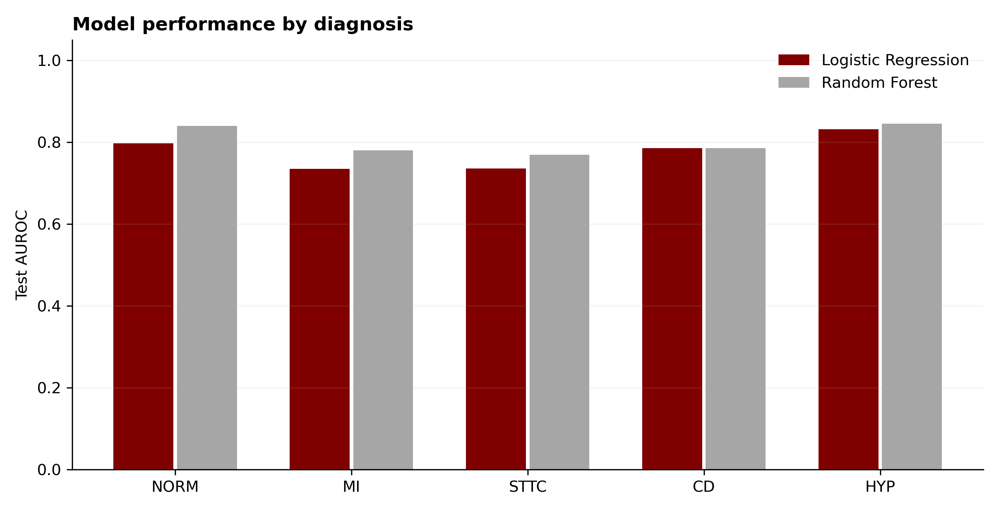
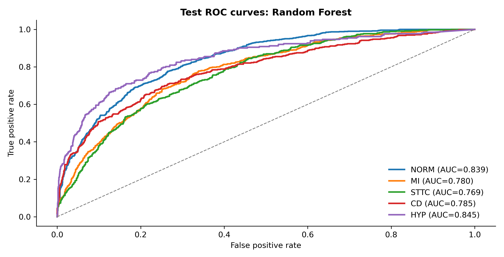

# Multi-label ECG Classification

This project uses the PTB-XL dataset to compare Logistic Regression and Random Forest for five ECG diagnostic categories. Six statistical features are extracted from each of 12 leads (72 features in total).

## Dataset
Download [PTB-XL from PhysioNet](https://physionet.org/content/ptb-xl/) and place `ptbxl_database.csv`, `scp_statements.csv`, and `records100/` under `data/`. Raw ECG data are not included in this repository.

## Run
```bash
pip install -r requirements.txt
python ECG_classification.py --root data --out outputs
```

## Method
- Construct multi-label targets from diagnostic codes.
- Extract waveform statistics and verify patient-independent splits.
- Impute missing values using training-set medians.
- Select the model by validation macro AUROC and evaluate on the test set.

## Results
The supplied experiment outputs show model performance by diagnosis and ROC curves for Random Forest.





Additional figures: [Diagnostic prevalence](outputs/01_label_distribution.png) and [Feature importance](outputs/04_feature_importance.png).

Random Forest achieved higher test macro AUROC than Logistic Regression, but lower recall at the default threshold. This is an educational classification project, not a clinically validated diagnostic tool.
